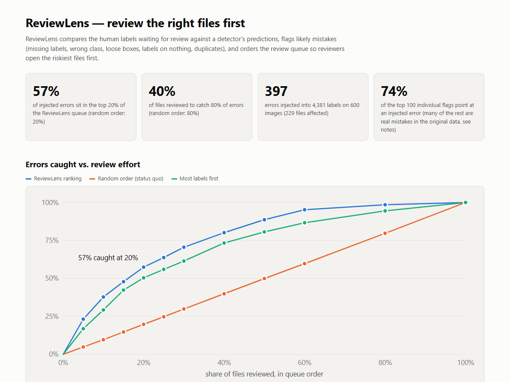

# ReviewLens: review the right files first

A proof of concept for Labellerr's review stage. ReviewLens checks human annotations against a detector's predictions. It flags likely mistakes and reorders the review queue so reviewers open the riskiest files first. It then hands that queue back to Labellerr through the official SDK.



## The problem I noticed

Labellerr has strong tooling for creating labels: SAM / SAM 2 / SAM 3, active learning, model-assisted labelling and Magic Wand confidence filtering. The review step still looks like this:

* A reviewer opens files one by one (`review` → `r_assigned` → accept / reject / skip).
* Nothing in the docs says how files are ordered or sampled for review.
* **Magic Wand** ranks *model pre-annotations* by the model's own confidence. Nothing ranks *human* labels by how likely they are to be wrong.
* **Quality Metrics** shows reviewer and client rejections after the fact, per annotator. It tells you quality was bad last week. It does not tell you which file to open now.

So review effort is spread evenly across files whose risk is very uneven. Labellerr also sells managed annotation (from $6/hr, 1,000+ annotators), so this cost lands partly on Labellerr's own delivery margin and SLAs, not only on customers.

## Who it helps

| Who | Pain today | What ReviewLens gives them |
|---|---|---|
| **Labellerr delivery / QA leads** running managed-annotation projects | Second-pass review is a large share of paid human hours. Client rejections hurt SLAs. | A ranked queue: senior reviewers get the riskiest ~20–40% first, and the rest can be sampled. |
| **ML team leads** on Pro/Enterprise with in-house annotators | They can't afford 100% review, so they sample randomly and miss clustered errors. | A defensible "what to review" list, plus suggested fixes (missing objects, class corrections). |
| **Client reviewers** (Labellerr's client-review stage) | They accept or reject in grid view, effectively at random. | The same queue, so client time goes to files most likely to be rejected. |

## How it works

```
Labellerr export (coco_json, status=review)      detector predictions (customer's own checkpoint,
          │                                       or any COCO-pretrained model as a start)
          └──────────────┬───────────────────────────────┘
                         ▼
         per-label checks, scores calibrated on the dataset itself
   missing label · wrong class · loose box · label on nothing · duplicate
                         ▼
     per-file risk = P(at least one real error)  (noisy-OR of flag scores)
                         ▼
   queue.csv · report.html · suggested_fixes_coco.json · bulk_assign_files(top N → senior reviewer)
```

**Self-calibration is the key design choice.** A raw detector flags too much: every object it sees that nobody labelled, and every label it can't find. ReviewLens therefore weights each flag by how often the model agrees with the humans elsewhere *in the same project*:

* "Missing label" is scored by the model's empirical precision for that class at that confidence.
* "Label on nothing" is scored by the model's empirical recall for that class and object size.

If the customer's model is weak on a class, flags for that class get quieter automatically. No extra training and no extra labels are needed.

## Results (600 COCO val2017 images, 4.4k labels, YOLO11m on CPU)

I injected realistic annotator mistakes with a seeded answer key: dropped boxes, confusable-class swaps, sloppy or shifted boxes, duplicates, and labels on nothing. One simulated annotator out of six is careless (3× error rate). I then measured how many errors a reviewer would hit for a given review budget.

| Label error rate | Files with ≥1 error | Errors caught in the top 20% of files<br>ReviewLens / random / most-labels-first | Files to review to catch 80% of errors<br>ReviewLens / random / most-labels-first |
|---|---|---|---|
| 4% | 24% | **54%** ±2 / 20% / 47% | **39%** / 80% / 51% |
| 8% | 38% | **54%** ±2 / 20% / 49% | **41%** / 80% / 47% |
| 16% | 56% | **53%** ±2 / 20% / 49% | **44%** / 80% / 49% |

*(5 seeds per row. Reproduce with `python -m scripts.sweep`.)*

* **About 2× fewer files to review for the same catch rate** compared with random order.
* "Most labels first" is a deliberately strong, model-free baseline, because crowded images simply hold more mistakes. ReviewLens still beats it by 4–7 points at 20% and needs 5–12 points less review effort at the 80% target. I report the honest margin over the strong baseline, not just the flattering margin over random.
* Per mistake type, ReviewLens points at the faulty box for 92% of duplicates, 94% of labels on nothing, 76% of wrong classes, 63% of loose boxes and 53% of missing labels. Missing labels are hardest because tiny or occluded objects are missed by the model too.
* **It finds real errors in COCO itself.** On the *original* labels I eyeballed the 20 highest-scoring flags (see [docs/img](docs/img)): ~10 look like genuine errors (unlabelled pedestrians and spectators, small cars labelled "truck", a bowl labelled "cup"), ~4 are guideline-ambiguous, and ~6 are model false alarms. That roughly matches the published finding that about half of algorithmically flagged label errors are real (Northcutt et al., NeurIPS 2021).
* **Annotator attribution is a weak signal.** The careless annotator does get the highest flag score per 100 images (151, versus 92–130 for the others), but image difficulty adds noise. It is a lead for the Quality Metrics dashboard, not a verdict on a person.

Open [`docs/report.html`](docs/report.html) in a browser (self-contained, works offline) for the interactive chart and the visual review queue.

## Run it

```bash
python -m venv .venv && .venv/Scripts/activate        # Windows; use bin/activate elsewhere
pip install torch torchvision --index-url https://download.pytorch.org/whl/cpu
pip install -r requirements.txt

# 1. data: COCO val2017 annotations -> data/annotations/instances_val2017.json, then
python -m scripts.prepare_coco_subset --n 600

# 2. benchmark with injected errors + answer key (runs YOLO11m once, ~8 min on CPU, cached)
python -m reviewlens.cli benchmark --clean data/coco_subset/clean.json \
    --images data/coco_subset/images --out out/benchmark --rate-scale 0.5 --notes docs/report_notes.html

# 3. on a real project: no answer key, just the queue
python -m reviewlens.cli triage --labels export.json --images imgs/ --weights your_best.pt --out out/triage

pytest -q
```

### Labellerr round trip (official SDK, `pip install git+https://github.com/Labellerr/SDKPython.git`)

```bash
export LABELLERR_API_KEY=... LABELLERR_API_SECRET=... LABELLERR_CLIENT_ID=...
python -m reviewlens.cli pull --project <project_id> --out export.json          # create_local_export(coco_json, status in review)
python -m reviewlens.cli triage --labels export.json --images imgs/ --out out/
python -m reviewlens.cli push --project <project_id> --queue out/queue.csv \
    --top 0.2 --reviewer lead@team.com                                         # dry run; add --apply to call bulk_assign_files
```

`pull` and `push` follow the SDK source (`create_local_export`, `list_files`, `bulk_assign_files`), but **I haven't run them against a live workspace yet**. Response fields I couldn't confirm are marked `ASSUMPTION` in `reviewlens/labellerr_io.py`. Suggested fixes are written to `suggested_fixes_coco.json` with a Magic-Wand-style `conf_bucket` per annotation. They are **not** uploaded automatically, because I don't know whether `upload_preannotations` merges with or overwrites human labels on an already-annotated file.

## Layout

```
reviewlens/checks.py       issue detection + self-calibration + file ranking   (the core, ~200 lines)
reviewlens/noise.py        realistic error injection with answer key (benchmark only)
reviewlens/evaluate.py     catch-rate curves, per-type recall, flag precision, annotator attribution
reviewlens/predict.py      Ultralytics wrapper, maps model class names onto project categories
reviewlens/labellerr_io.py Labellerr SDK pull / push
reviewlens/report.py       self-contained HTML report
scripts/                   data prep, robustness sweep
tests/                     unit tests for every check, calibration and noise reproducibility
```

## What I'd build next (if a customer call validates it)

1. **Run it inside Labellerr instead of beside it.** Write ReviewLens risk into a file tag such as `reviewlens:high`, so the existing Smart File Filtering and grid view can sort by it. Overlay the flags in the review screen the way Magic Wand overlays pre-annotations.
2. **Sample the low-risk tail instead of skipping it.** Fully review the top-risk files and spot-check a random 5–10% of the rest, which gives an unbiased estimate of the residual error rate. A QA lead can sign off on that number; a pure ranking gives them nothing to sign.
3. **Learn from reviewer decisions.** Every accept or reject in Labellerr is a free label for "was this flag real?". A small model trained on those would replace the hand-set thresholds within a few hundred reviews.
4. **Extend beyond boxes.** Polygons and masks (IoU on masks, SAM-based boundary checks), video (track-consistency checks: a label that flickers across frames is almost always an error), and classification (confident-learning style).
